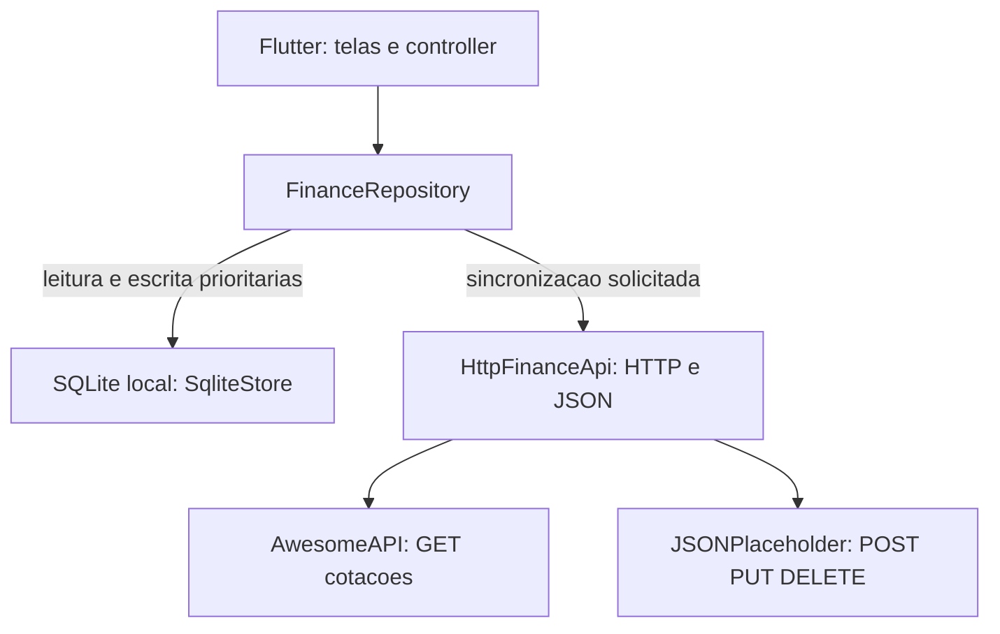

# Finanças PBL — AP2B (Tema 06)

**Computação Móvel | Faculdade Multivix | Sistemas de Informação | 2026/2**  
**Professor:** Edgard da Cunha Pontes  
**Grupo:** 9  
**Tema 06:** Controle Financeiro e Orçamentário

## Integrantes

- Caio Rohr Vargas Ribeiro
- João Eduardo Herculano Galito
- João Lucas Rodrigues Almeida
- Pedro Henrique de Paula Caetano

## Objetivo e continuidade da AP1B

O projeto dá continuidade ao [Finanças PBL — AP1B](https://github.com/Pedr0HPC/financas_pbl), originalmente desenvolvido em Dart. A AP2B evolui as regras de receitas, despesas, categorias, metas e simulação de juros compostos para uma aplicação Flutter, com formulários, navegação, persistência SQLite, consumo de API REST e testes automatizados.

A lógica da AP1B foi **adaptada e parcialmente reimplementada**, não simplesmente copiada. Para evitar problemas de precisão em cálculos financeiros, lançamentos monetários são armazenados em **centavos inteiros**. Receitas aumentam o saldo e despesas o reduzem. O saldo pode ficar negativo, decisão de projeto diferente da regra de saldo insuficiente da primeira etapa.

## Funcionalidades

- **Dashboard:** saldo, total de receitas, despesas e registros pendentes.
- **Lançamentos:** cadastro, consulta, edição e exclusão lógica (*tombstone*).
- **Categorias:** cadastro, edição e limites orçamentários.
- **Metas:** valor-alvo, total acumulado e prazo.
- **Relatórios:** agrupamento de despesas por categoria e indicação de orçamento excedido.
- **Simulador:** projeção de juros compostos, sem alterar lançamentos reais.
- **Cotações:** consulta de USD/BRL e EUR/BRL pela AwesomeAPI, com cache SQLite.
- **Sincronização demonstrativa:** envio de pendências por HTTP para a JSONPlaceholder e histórico local de tentativas.
- **Funcionamento offline:** leitura e alterações de dados financeiros no banco local sem depender de rede.

## Navegação — 14 rotas

| Rota | Função |
|---|---|
| `/` | Dashboard |
| `/lancamentos` | Listagem de lançamentos |
| `/novo` | Cadastro de lançamento |
| `/editar` | Edição de lançamento (argumento `Lancamento`) |
| `/detalhes` | Detalhes de lançamento (argumento `Lancamento`) |
| `/categorias` | Listagem de categorias |
| `/nova-categoria` | Cadastro e edição de categoria |
| `/metas` | Listagem de metas |
| `/nova-meta` | Cadastro e edição de meta |
| `/relatorios` | Relatórios por categoria |
| `/cotacoes` | Consulta e cache de cotações |
| `/sincronizacao` | Diagnóstico e envio de pendências |
| `/simulador` | Juros compostos |
| `/configuracoes` | Informações do aplicativo |

O aplicativo usa Material Design 3, `Scaffold`, `AppBar`, `ListView.builder`, `Dismissible`, `Form`, `GlobalKey<FormState>`, `TextEditingController`, `TextFormField` e `SnackBar`. As rotas são definidas em `onGenerateRoute`, com verificação de argumentos.

## Arquitetura Offline-First



O **SQLite é a fonte única da verdade (*Single Source of Truth*)** da interface: todas as consultas, inclusões, alterações e exclusões locais passam pelo repositório e são persistidas antes do envio à rede. Novos lançamentos ou alterações ficam com `sincronizado = 0` até que o serviço HTTP retorne uma resposta considerada válida.

A exclusão é lógica (`excluido = 1`), permitindo enviar posteriormente a operação `DELETE`. Caso haja falha de rede ou erro HTTP, a pendência permanece armazenada. A confirmação verifica o ID e a revisão do registro para não marcar como sincronizada uma versão modificada durante o envio.

**Limitação importante:** a JSONPlaceholder **não persiste** os lançamentos financeiros enviados. O status sincronizado indica **aceitação demonstrativa da requisição**, não backup em servidor. Não há banco remoto próprio nesta entrega. Uma versão de produção exigiria autenticação, armazenamento remoto real, recuperação via GET e resolução de conflitos.

## APIs utilizadas

| Serviço | Endpoint | Método | Finalidade |
|---|---|---|---|
| AwesomeAPI | `https://economia.awesomeapi.com.br/json/last/USD-BRL,EUR-BRL` | GET | Buscar cotações |
| JSONPlaceholder | `https://jsonplaceholder.typicode.com/posts` | POST | Simular inclusão remota |
| JSONPlaceholder | `https://jsonplaceholder.typicode.com/posts/1` | PUT | Simular atualização remota |
| JSONPlaceholder | `https://jsonplaceholder.typicode.com/posts/1` | DELETE | Simular exclusão remota |

A integração HTTP está em `lib/datasources/remote_api.dart`, com `package:http`, `Future`, `async/await`, serialização JSON, verificação de códigos de status e limite de tempo para requisições.

## Plataformas disponíveis

- **Android:** pasta `android/` já gerada e versionada. O workflow do GitHub Actions executa a compilação de um APK de depuração.
- **Web:** pasta `web/` já incluída para apresentação pelo navegador. A versão Web usa `sqflite_common_ffi_web` e os arquivos `sqlite3.wasm` e `sqflite_sw.js` para SQLite no navegador.

O suporte Web é uma **alternativa de demonstração**. A entrega principal da disciplina permanece sendo o aplicativo Flutter com plataforma Android. O armazenamento Web depende do navegador, do perfil e da origem (URL/porta) acessada; não compartilha automaticamente o banco com o Android.

## Execução no GitHub Codespaces — navegador

No terminal do Codespaces, na pasta que contém `pubspec.yaml`:

```bash
cd /workspaces/financas_pbl_2
flutter --version
flutter pub get
flutter analyze
flutter test
```

Com a análise e os testes aprovados, execute:

```bash
flutter run -d web-server --web-hostname 0.0.0.0 --web-port 8080
```

Na interface do Codespaces, abra a aba **PORTS**, localize a porta **8080** e escolha **Open in Browser**. **Mantenha o terminal do servidor em execução** enquanto apresenta o sistema. Para encerrar, use `Ctrl+C`.

Se ocorrer erro relacionado aos recursos SQLite Web, confira a presença de `web/sqlite3.wasm` e `web/sqflite_sw.js`. Somente se estiverem ausentes, execute:

```bash
dart run sqflite_common_ffi_web:setup
```

O carregamento inicial exige acesso ao Codespaces. Com a página já aberta, o DevTools do navegador pode simular a perda de conectividade, mas isso **não comprova** que o aplicativo pode ser carregado do zero sem rede. Requisições da AwesomeAPI também podem ser limitadas por CORS no navegador.

## Execução Android

Para compilar ou executar Android localmente, instale o Flutter SDK e o Android SDK. Como a pasta `android/` **já existe**, não é necessário executar `flutter create` novamente.

```bash
flutter doctor -v
flutter pub get
flutter devices
flutter run -d <id-do-dispositivo-android>
```

Confira se `android/app/src/main/AndroidManifest.xml` possui a permissão de internet:

```xml
<uses-permission android:name="android.permission.INTERNET" />
```

Se o computador não tiver SDK Android, use o GitHub Actions para a compilação. O workflow está em `.github/workflows/flutter.yml` e executa `flutter pub get`, `flutter analyze`, `flutter test` e `flutter build apk --debug`. Quando aprovado, o APK está disponível na seção **Artifacts**, sob o nome `financas-pbl-ap2b-tema06-apk` (enquanto o artefato permanecer disponível no GitHub).

[Consultar GitHub Actions do projeto](https://github.com/Pedr0HPC/financas_pbl_2/actions)

## Testes e validação

A suíte inclui **50 testes de unidade** (`domain_test.dart`: 30; `repository_test.dart`: 13; `remote_api_test.dart`: 7) e **10 testes de widgets** (`widgets_test.dart`: 10), totalizando **60 casos**, atendendo aos mínimos exigidos na AP2B.

Os testes cobrem regras financeiras, serialização, situações de falha de rede e componentes visuais com dependências simuladas. O GitHub Actions teve uma execução bem-sucedida do fluxo de análise, testes e compilação Android na revisão `ba14e22`, em **10/11/2026**. Isso **não substitui** os testes manuais de banco SQLite Web, interação completa e integração HTTP no navegador da apresentação.

Comandos para nova verificação:

```bash
dart format lib test
flutter analyze
flutter test
flutter test --coverage
```

## Demonstração sugerida para a defesa

1. Abra o app no navegador pelo Codespaces e mostre o Dashboard.
2. Cadastre uma receita de R$ 3.000,00 e uma despesa de R$ 200,00; confira saldo de R$ 2.800,00.
3. Abra `F12` → **Network** → **Offline**, sem atualizar a página; cadastre uma nova despesa e mostre o indicador de pendência.
4. Volte a **No throttling**, abra **Sincronização** e solicite o envio de pendências.
5. Em **Network**, observe requisições e respostas da JSONPlaceholder. Explique que são **simuladas e não representam backup remoto**.
6. Mostre a tela de cotações e o cache, se as requisições estiverem disponíveis no navegador.
7. Em outro terminal do Codespaces, execute `flutter test` e apresente o resultado.

Para a demonstração com a rede desligada, não recarregue a página do aplicativo. Antes de apresentar, verifique se a URL encaminhada do Codespaces está acessível no computador da sala e se a tela de cadastro funciona nessa sessão.

## Estrutura principal do projeto

```text
.github/workflows/flutter.yml
android/
web/
lib/
  main.dart
  models/finance_models.dart
  domain/finance_rules.dart
  datasources/local_store.dart
  datasources/remote_api.dart
  repositories/finance_repository.dart
  controllers/finance_controller.dart
  screens/
  widgets/app_shell.dart
test/
  helpers/fakes.dart
  domain_test.dart
  repository_test.dart
  remote_api_test.dart
  widgets_test.dart
docs/
  ARQUITETURA.md
  ROTEIRO_DEMONSTRACAO.md
  PERGUNTAS_DEFESA.md
  CHECKLIST_ENTREGA.md
  CONTINUIDADE_AP1B.md
  EMAIL_ENTREGA.md
  PUBLICAR_GITHUB.md
pubspec.yaml
pubspec.lock
README.md
```

## Declaração de uso de Inteligência Artificial

Na AP1B, conforme a documentação original do grupo, foi utilizado o **Gemini** como apoio à estruturação, sintaxe, depuração e documentação. Na AP2B, o **ChatGPT (OpenAI)** foi utilizado como apoio para interpretar o enunciado, propor e revisar trechos Flutter/Dart, auxiliar na correção de erros, elaborar cenários de testes e produzir documentação e roteiro de defesa. O grupo é responsável por executar, verificar, compreender e explicar o código entregue, inclusive durante modificações solicitadas na avaliação presencial.

## Entrega

- **Repositório:** https://github.com/Pedr0HPC/financas_pbl_2
- **Prazo do link:** 12/11/2026.
- **E-mail:** edgardpontes@professor.multivix.edu.br
- **Assunto:** `[AP2B - Computação Móvel] - Tema 06 - Grupo 9`
- **Defesa técnica:** prevista no enunciado para 10/11/2026, com avaliação individual de domínio do código e da arquitetura.

## Referências

- [Repositório AP1B — Finanças PBL](https://github.com/Pedr0HPC/financas_pbl)
- [Documentação oficial Flutter](https://docs.flutter.dev/)
- [Documentação oficial Dart](https://dart.dev/language)
- [sqflite](https://pub.dev/packages/sqflite)
- [sqflite_common_ffi_web](https://pub.dev/packages/sqflite_common_ffi_web)
- [package:http](https://pub.dev/packages/http)
- [AwesomeAPI — documentação de moedas](https://docs.awesomeapi.com.br/api-de-moedas)
- [JSONPlaceholder — Guide](https://jsonplaceholder.typicode.com/guide/)
- MULTIVIX. *Computação Móvel: Avaliação Processual 2B — 2026/2*.
