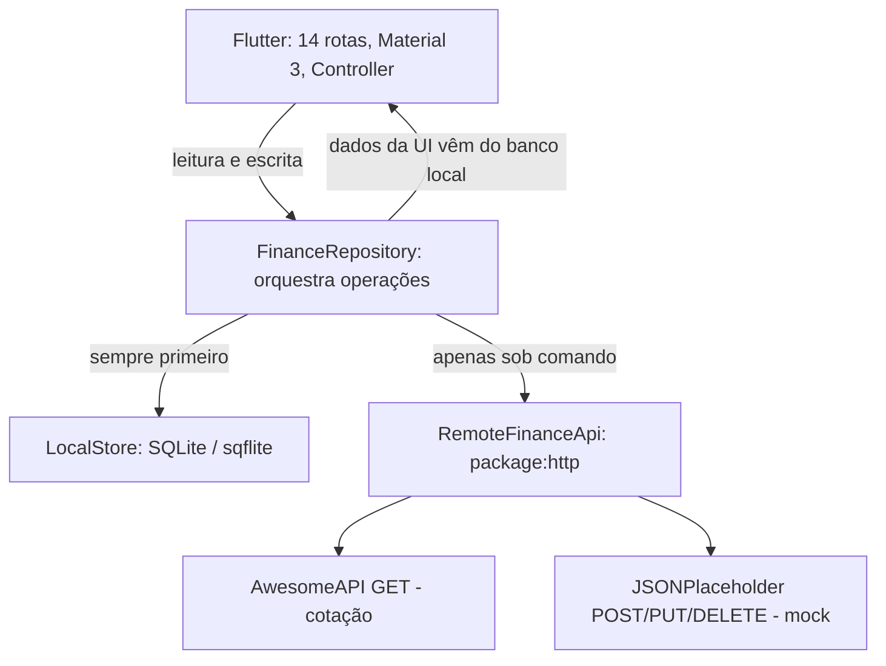

# Finanças PBL — AP2B (Tema 06)

**Computação Móvel • Faculdade Multivix • Sistemas de Informação • 2026/2**  
**Professor:** Edgard da Cunha Pontes  
**Tema 06:** Controle Financeiro e Orçamentário

## Integrantes (mesma equipe da AP1B)

- Caio Rohr Vargas Ribeiro
- João Eduardo Herculano Galito
- João Lucas Rodrigues Almeida
- Pedro Henrique de Paula Caetano

**Número do grupo:** Grupo 9 - Tema 06.

## Contexto / continuidade do Marco 1

O [repositório original da AP1B](https://github.com/Pedr0HPC/financas_pbl) criou, em Dart puro, regras para receitas, despesas, categorias, metas de economia e simulação de juros compostos. A AP2B evolui esses **conceitos de negócio** para uma interface Flutter, com modelos serializáveis em `lib/models`, regras puras em `lib/domain`, persistência SQLite e uma camada Repository. A implementação desta entrega **reestrutura/reimplementa** partes da API de domínio anterior; não é uma cópia byte a byte dos arquivos da AP1B.

Mudanças: valores monetários agora são registrados em **centavos inteiros** para evitar erros de arredondamento; receitas somam e despesas subtraem o saldo; categorizações, metas e simulação permanecem disponíveis. O saldo é calculado a partir dos lançamentos ativos persistidos localmente. Por ser um registro financeiro, **saldo negativo é permitido** quando despesas superam receitas; isso é uma decisão de adaptação em relação à regra de saldo insuficiente da AP1B, que deve ser explicada na defesa.

## Funcionalidades

- Dashboard com saldo, totais de receitas/despesas e pendências.
- CRUD local de lançamentos (inclusão, consulta, edição e exclusão lógica).
- Cadastro e edição de categorias e respectivos limites orçamentários.
- Metas financeiras com valor-alvo, acumulado e prazo.
- Relatório de despesas por categoria e indicação de orçamento excedido.
- Simulação de juros compostos, sem alterar dados reais.
- Consulta assíncrona USD/BRL e EUR/BRL via **AwesomeAPI** e cache no SQLite.
- Envio demonstrativo de registros pendentes (POST/PUT/DELETE) ao JSONPlaceholder.
- Estado visual por lançamento (ícone de nuvem) e logs de sincronização.
- Aplicação funciona sem internet para todos os formulários e consultas locais.

## 14 rotas navegáveis

| Rota | Função |
|---|---|
| `/` | Dashboard |
| `/lancamentos` | Lista de lançamentos com Dismissible |
| `/novo` | Cadastro validado |
| `/editar` | Edição validada (argumento: Lancamento) |
| `/detalhes` | Detalhes (argumento: Lancamento) |
| `/categorias` | Lista de categorias |
| `/nova-categoria` | Cadastro/edição de categoria |
| `/metas` | Lista de metas |
| `/nova-meta` | Cadastro/edição de meta |
| `/relatorios` | Relatórios por categoria |
| `/cotacoes` | Cotações com cache |
| `/sincronizacao` | Diagnóstico e envio de pendências |
| `/simulador` | Juros compostos |
| `/configuracoes` | Informações e políticas do projeto |

O roteamento usa `onGenerateRoute` com validação do tipo dos argumentos. Widgets incluem `Scaffold`, `AppBar`, `ListView.builder`, `Dismissible`, `Form`, `GlobalKey<FormState>`, `TextEditingController`, `TextFormField`, `SnackBar` e Material Design 3.

## Arquitetura Offline-First



**Single Source of Truth:** a interface sempre lê dados financeiros do SQLite. Cadastro/edição/exclusão alteram o banco antes de qualquer requisição externa; cada movimento inicia com `sincronizado = 0`. A exclusão utiliza marcador `excluido = 1` (tombstone), permitindo sincronizar o DELETE posteriormente. Em caso de falha HTTP, o registro continua pendente. O envio bem-sucedido atualiza o indicador **somente se a revisão local ainda for a mesma**, evitando que uma alteração simultânea seja marcada como sincronizada indevidamente.

A API JSONPlaceholder retorna sucesso **simulado**: ela não persiste os lançamentos do grupo e **não pode ser utilizada como backup real**. Portanto, o ícone representa *envio aceito pelo endpoint de demonstração*, não garantia de cópia remota. Para um produto real, substituir por backend próprio que forneça autenticação, identificadores estáveis, consistência e resolução de conflitos.

## Endpoints usados

| Serviço | Endpoint | Operação | Finalidade |
|---|---|---|---|
| AwesomeAPI | `https://economia.awesomeapi.com.br/json/last/USD-BRL,EUR-BRL` | GET | Buscar USD/BRL e EUR/BRL |
| JSONPlaceholder | `https://jsonplaceholder.typicode.com/posts` | POST | Demonstrar envio de novo lançamento |
| JSONPlaceholder | `https://jsonplaceholder.typicode.com/posts/1` | PUT | Demonstrar edição de lançamento |
| JSONPlaceholder | `https://jsonplaceholder.typicode.com/posts/1` | DELETE | Demonstrar exclusão |

`http.Client`, `Future`, `async/await`, `dart:convert`, validação de HTTP 2xx e `.timeout(Duration(seconds: 5))` estão em `lib/datasources/remote_api.dart`.

## Como executar (Windows, Android Studio ou VS Code)

1. Instalar **Flutter SDK**, **Android Studio** (com SDK/Emulador) e extensões Flutter/Dart da IDE.
2. No terminal na **raiz do projeto** (onde está `pubspec.yaml`), executar:

   ```bash
   flutter doctor
   flutter create --project-name financas_pbl_ap2b --platforms=android .
   flutter pub get
   flutter test
   flutter run
   ```

   O pacote contém o código Flutter e arquivos de configuração do projeto, mas **não inclui a pasta `android/` gerada pelo Flutter SDK**. O comando `flutter create` cria os arquivos de plataforma necessários sem exigir que eles sejam escritos manualmente. Para iOS, no macOS com Xcode, gerar também `--platforms=ios`.

3. No arquivo `android/app/src/main/AndroidManifest.xml`, garantir esta permissão **antes** da tag `<application>`:

   ```xml
   <uses-permission android:name="android.permission.INTERNET" />
   ```

4. Selecionar emulador Android ou dispositivo físico conectado. `flutter devices` lista as opções.
5. Ativar/desativar modo avião para demonstrar **cadastro e consulta locais**. Desativar modo avião e ir em *Sincronização > Sincronizar agora* para enviar pendências ao mock.

No Windows, também há um script `bootstrap_android.ps1` que automatiza os passos de criação dos arquivos Android e inclusão da permissão de internet. Execute após conferir o conteúdo do script.

**O projeto foi preparado, mas Flutter SDK e emulador não estão disponíveis no ambiente em que os arquivos foram gerados.** Portanto `flutter pub get`, `flutter analyze`, `flutter test` e `flutter run` **não foram executados ou validados aqui**. Execute-os antes de entregar; um workflow de GitHub Actions está incluído para auxiliar na validação.

## Testes

Os arquivos em `test/` contêm **50 casos de unidade** (`domain_test.dart`: 30; `repository_test.dart`: 13; `remote_api_test.dart`: 7) e **10 casos de widget** (`widgets_test.dart`: 10), para atender aos mínimos de 20 e 5. Usam `flutter_test` (`group`, `test`, `expect`, `throws...`, `testWidgets`, `pumpWidget`, `tester.tap`, `find.text`) com injeção de dependência, fake de SQLite e fake de rede. A existência dos testes **não substitui comprovação de execução com sucesso**.

```bash
dart format lib test
flutter analyze
flutter test
flutter test --coverage
```

## Estrutura do projeto

```text
lib/
  main.dart                     # inicialização e validação das rotas
  models/finance_models.dart    # entidades toMap/fromMap e serialização
  domain/finance_rules.dart     # regras Dart puras da AP1B adaptadas
  datasources/local_store.dart  # contrato DAO + implementação sqflite
  datasources/remote_api.dart   # HTTP, timeouts e JSON
  repositories/finance_repository.dart
  controllers/finance_controller.dart
  screens/                     # telas e formulários
  widgets/app_shell.dart       # Scaffold, drawer e feedback
 test/
  helpers/fakes.dart            # doubles de banco e HTTP
  domain_test.dart
  repository_test.dart
  remote_api_test.dart
  widgets_test.dart
 docs/
  ARQUITETURA.md
  ROTEIRO_DEMONSTRACAO.md
  PERGUNTAS_DEFESA.md
  CHECKLIST_ENTREGA.md
  CONTINUIDADE_AP1B.md
  EMAIL_ENTREGA.md
  PUBLICAR_GITHUB.md
```

## Declaração de Uso de Inteligência Artificial

Na **AP1B**, o README do repositório anterior informa o uso do **Gemini** como apoio para estruturação, sintaxe, depuração e documentação. Na produção desta **proposta de AP2B**, houve auxílio do **ChatGPT (OpenAI, GPT-6)** para análise do enunciado, reestruturação de código Flutter/Dart, propostas de testes, documentação e roteiro de defesa.

## Como submeter

- Criar um **novo** repositório GitHub e subir os arquivos desta pasta, depois de gerar/validar a plataforma Android e ajustar o número do grupo.
- Enviar o **link**, não apenas o arquivo ZIP, para `edgardpontes@professor.multivix.edu.br` até **12/11/2026**.
- Assunto: **`[AP2B - Computação Móvel] - Tema 06 - Grupo [Número do Grupo]`**.
- Defesa presencial prevista para **10/11/2026**. A nota da entrevista é individual. Cada integrante deve ser capaz de explicar e alterar o código.

## Referências

- [Repositório AP1B — Pedr0HPC/financas_pbl](https://github.com/Pedr0HPC/financas_pbl)
- [Documentação oficial Flutter](https://docs.flutter.dev/)
- [Documentação oficial Dart](https://dart.dev/language)
- [sqflite no pub.dev](https://pub.dev/packages/sqflite)
- [package:http no pub.dev](https://pub.dev/packages/http)
- [AwesomeAPI - Cotações](https://docs.awesomeapi.com.br/api-de-moedas)
- [JSONPlaceholder - Guide](https://jsonplaceholder.typicode.com/guide/)
- MULTIVIX. Computação Móvel: Avaliação Processual 2B — 2026/2.
